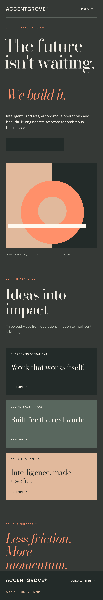

# ACCENTGROVE® — AI Venture Studio

**Vogue × Creative Editorial · Warm Charcoal Edition**

Responsive, static landing page concept built with semantic HTML, CSS and minimal vanilla JavaScript.

## Website

- [View the website source](./index.html)
- **Deployment:** GitHub Pages workflow runs on `main` only after reviewed changes are merged.
- **Public access prerequisite:** The repository must be public, or the GitHub plan must support Pages on private repositories. Pages must be configured to deploy from GitHub Actions in **Settings → Pages**.
- **Expected URL after successful deployment:** https://accentgrove.github.io/brand-showcase/ (not live until verified).
- No build system, npm dependencies, or backend required.
- Google Fonts are requested at runtime; system fonts are used as fallbacks.

## Desktop design preview

## Mobile design preview

## Editable source

[Open Figma design](https://www.figma.com/design/lNan8qH5Ee8f8xMlhOHrgh)

## Review checklist

- [ ] Review desktop at 1440px and mobile at 390px and 320px
- [ ] Confirm links, contact destination, keyboard navigation and menu behavior
- [ ] Confirm content and business claims
- [ ] Confirm Pages availability and public repository visibility
- [ ] Approve and merge PR, then verify the Pages deployment URL

**Scope:** Marketing concept, not a functioning SaaS product. Venture descriptions are proposed directions, not customer case studies.
